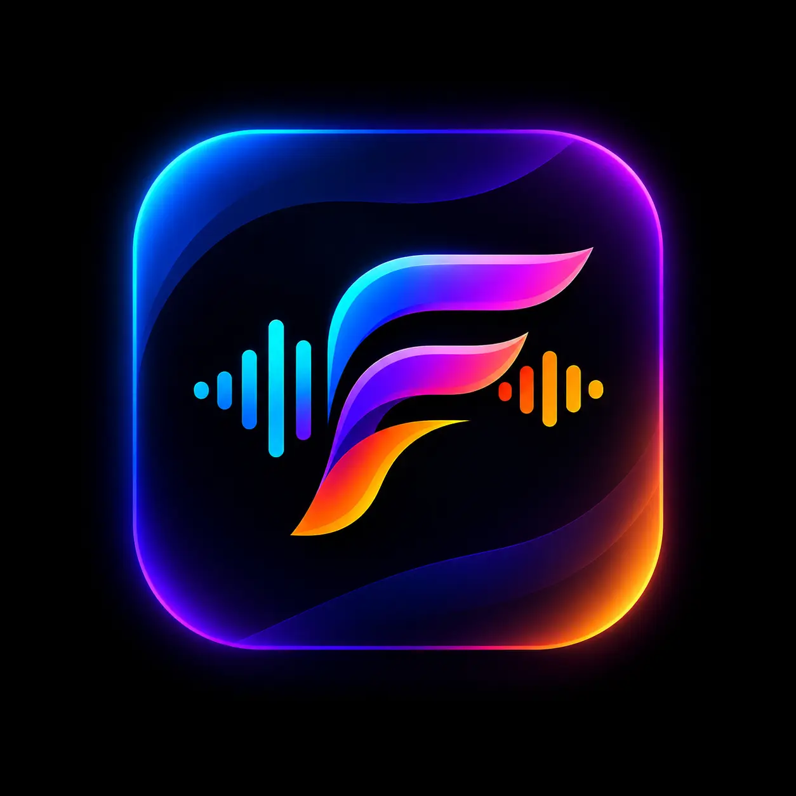
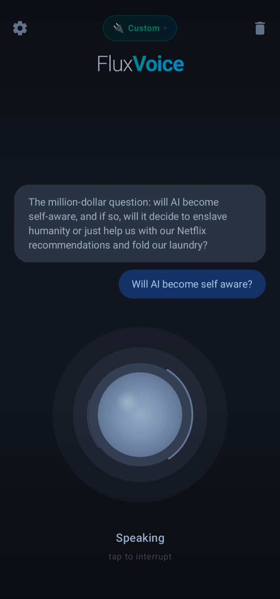
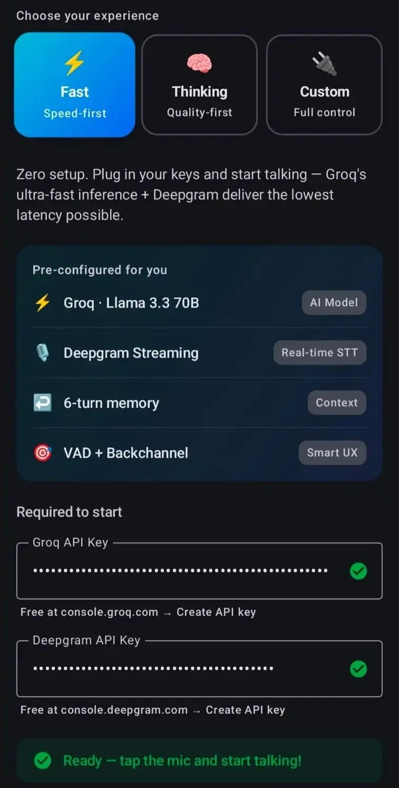
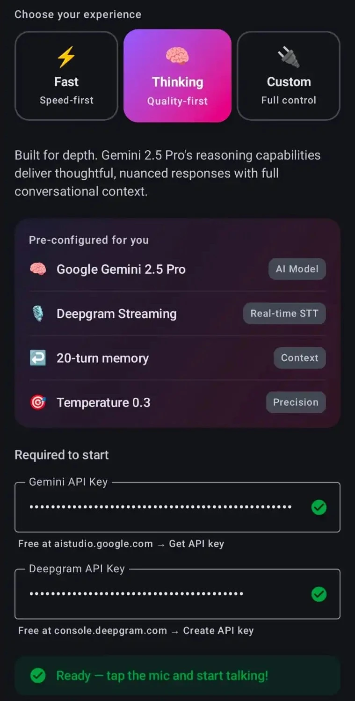
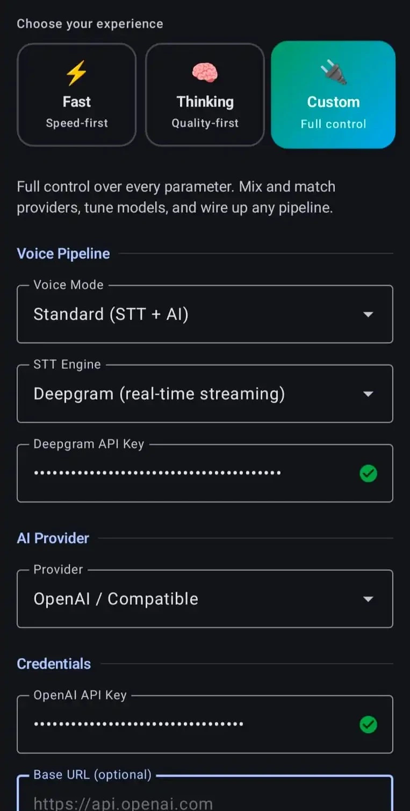
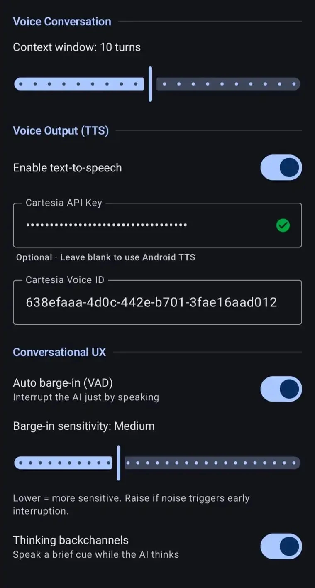

<h1 align="center">FluxVoice</h1>

<p align="center">
  <b>Real-Time Conversational Voice AI Engine & Interactive Workbench for Android</b>
</p>

<p align="center">
  Streaming STT → LLM → TTS pipeline with sub-500ms turnaround, hardware-accelerated barge-in, and sentence-level voice orchestration.
</p>

<p align="center">
  <a href="https://central.sonatype.com/search?q=com.techrifter.fluxvoice">
    
  </a>
  <a href="LICENSE">
    
  </a>
  
  
  
</p>

<br/>

<table align="center">
<tr>
<td align="center" valign="middle">

</td>
<td width="40"></td>
<td align="center" valign="middle">

</td>
</tr>
</table>

<p align="center">
  <sub>Natural human cadence • Speak & interrupt anytime • Real-time sentence streaming • Universal BYOK</sub>
</p>

---

## What is FluxVoice?

Building a voice AI conversation system on Android from scratch requires complex audio engineering: handling raw PCM microphone capture, hardware acoustic echo cancellation, streaming token parsing, live speech synthesis, and real-time interruption handling (barge-in).

**FluxVoice solves this entirely.**

FluxVoice is an end-to-end voice AI ecosystem consisting of two complementary parts:

1. **The FluxVoice SDK**: Six modular, lightweight Android libraries published on Maven Central. Drop in a ready-to-use voice screen in ~10 lines of Compose, embed an interactive orb widget, or use the headless engine with your own UI.
2. **The FluxVoice Playground & Workbench Android App**: A production-grade mobile workbench published on Google Play. It lets you test speech models, inspect millisecond-level telemetry, configure custom pipelines, and export clean, production-ready Kotlin SDK code with one tap.

```
       ┌──────────────┐     ┌──────────────┐     ┌──────────────┐
Mic ──►│ Streaming STT├────►│Streaming LLM ├────►│Streaming TTS ├──► Speaker
       └──────┬───────┘     └──────────────┘     └──────┬───────┘
              ▲                                         │
              │             WebRTC VAD                  │
              └───────── Auto Barge-In (AEC) ───────────┘
```

---

## Core Features

- ⚡ **Sub-500ms Conversational Turnaround**: Speech is synthesized sentence-by-sentence *as the LLM streams*. Audio starts playing before the language model finishes generating its full response.
- 🎙️ **Hardware-Accelerated Auto Barge-In**: WebRTC Voice Activity Detection (VAD) coupled with Android hardware Acoustic Echo Cancellation (AEC). When you speak over the assistant, playback stops immediately and speech recognition re-opens with zero audio feedback.
- 🧩 **Universal BYOK (Bring Your Own Key & Endpoints)**:
  - **Speech-to-Text (STT)**: Deepgram Nova-3, Groq Whisper Turbo, OpenAI Whisper, or any custom OpenAI-compatible `/v1/audio/transcriptions` server (Together AI, LocalAI, FastWhisper, Whisper.cpp).
  - **Language Models (LLM)**: Groq LPUs (`openai/gpt-oss-120b`, `qwen/qwen3.8-27b`), Google Gemini 2.5 Flash, OpenAI `gpt-4o-mini`, OpenRouter universal directory, or any OpenAI-compatible `/v1/chat/completions` server.
  - **Voice Synthesis (TTS)**: Cartesia Sonic 3.6, ElevenLabs Neural, Deepgram Aura, OpenAI Speech, Custom `/v1/audio/speech`, or 100% offline on-device Android TTS.
  - **All-in-One Voice Agents**: Full-duplex ElevenLabs Conversational AI WebSocket integration with server-side turn-taking and speech synthesis.
- 🛠️ **Visual Pipeline Studio & 1-Click Code Export**: Design and test custom pipelines in the app, verify live model latencies, and export copy-pasteable Kotlin Compose SDK code for your projects.
- 📊 **Real-Time Telemetry HUD & Turn Benchmarks**: Live tracking of STT latency, Time-to-First-Token (TTFT), Time-to-First-Audio (TTFA), and total roundtrip duration. Every turn record includes color-coded stack badges (`STT`, `LLM`, `TTS`) and barge-in indicators.
- 🔐 **Privacy-First Hardware Key Vault**: Commercial API keys are encrypted directly on-device via Android Keystore (AES-256 GCM) with zero plaintext disk storage. Google Gemini calls use secure `x-goog-api-key` header transport rather than URL query parameters.
- 📈 **Scalable, Partitioned Telemetry**: Anonymous usage metrics partitioned across dedicated Firestore collections (`anonymous_users`, `user_model_stats`, `model_telemetry`, `latency_telemetry`) with zero transcript data collected.

---

## Which Module Do I Need?

FluxVoice is modular. Add only the dependencies your application needs:

| I want to… | Module | What you write |
|---|---|---|
| Drop a complete, animated voice screen into my app | `fluxvoice-compose` | ~10 lines of Compose |
| Build my own custom UI, just need the voice pipeline | `fluxvoice-android` | Your own View or Compose UI |
| Use the core interfaces and build custom engines | `fluxvoice-core` | Your own engine & UI |
| Stream live speech recognition via WebSocket | `fluxvoice-stt-deepgram` | Pass your API key |
| Stream chat completions (Groq, OpenAI, Gemini, etc.) | `fluxvoice-provider-llm` | Pass key and model ID |
| Stream ultra-low latency voice synthesis | `fluxvoice-tts-cartesia` | Pass key and voice ID |

### Dependency Graph

```
fluxvoice-compose ──► fluxvoice-android ──► fluxvoice-core ◄── fluxvoice-stt-deepgram
                                                           ◄── fluxvoice-provider-llm
                                                           ◄── fluxvoice-tts-cartesia
```

Adding `fluxvoice-compose` transitively includes `fluxvoice-android` and `fluxvoice-core`. Provider modules depend only on `fluxvoice-core` and can be mixed and matched freely.

---

## Free Tiers & Supported Services

FluxVoice connects directly to official AI provider APIs. You can start testing in minutes using free developer tiers:

| Provider | Service | Default Model / Target | Free Tier & Availability |
|---|---|---|---|
| **Deepgram** | Speech-to-Text & Text-to-Speech | `nova-3`, `aura-asteria-en` | \$200 free credit (~45,000 mins STT / Aura TTS) |
| **Groq Cloud** | LLM & STT | `openai/gpt-oss-120b`, `whisper-large-v3-turbo` | Free API key on ultra-fast Groq LPUs |
| **Google Gemini** | Language Model | `gemini-2.5-flash` | Free tier via Google AI Studio |
| **OpenAI** | STT, LLM, TTS | `whisper-1`, `gpt-4o-mini`, `tts-1` | Standard pay-as-you-go / developer credits |
| **OpenRouter** | Multi-Model LLM Gateway | 300+ models (Llama 3.3, DeepSeek, Claude, etc.) | Free and low-cost models via unified API |
| **Cartesia** | Text-to-Speech | `sonic-3.6` | Free starter tier (~20k characters) |
| **ElevenLabs** | All-in-One Voice Agent & TTS | Conversational Agent, `eleven_flash_v2_5` | Free starter credits |
| **Local / Ollama** | Language Model | `http://localhost:11434` (e.g. `llama3.2`) | 100% free, offline, private on your local network |
| **Android System** | Text-to-Speech | Device default voice | 100% free, offline, zero API keys required |
| **Custom BYOK** | STT, LLM, TTS | Any OpenAI-compatible endpoint | Self-hosted (vLLM, LocalAI, Whisper.cpp) or cloud |

---

## Quickstart

Add a fully animated voice conversation screen to your Android app in 3 steps:

### 1. Add Dependencies

```kotlin
// settings.gradle.kts - add JitPack (required for WebRTC VAD)
dependencyResolutionManagement {
    repositories {
        google()
        mavenCentral()
        maven { url = uri("https://jitpack.io") }
    }
}
```

```kotlin
// app/build.gradle.kts
dependencies {
    implementation("com.techrifter.fluxvoice:fluxvoice-compose:1.0.0")
    implementation("com.techrifter.fluxvoice:fluxvoice-stt-deepgram:1.0.0")
    implementation("com.techrifter.fluxvoice:fluxvoice-provider-llm:1.0.0")
    implementation("com.techrifter.fluxvoice:fluxvoice-tts-cartesia:1.0.0")
}
```

### 2. Add Android Permissions

```xml
<!-- AndroidManifest.xml -->
<uses-permission android:name="android.permission.INTERNET" />
<uses-permission android:name="android.permission.RECORD_AUDIO" />
```

`RECORD_AUDIO` runtime permission is requested automatically when the user taps to speak.

### 3. Display the Voice Screen

```kotlin
class MainActivity : ComponentActivity() {
    override fun onCreate(savedInstanceState: Bundle?) {
        super.onCreate(savedInstanceState)
        enableEdgeToEdge()
        setContent {
            MaterialTheme(colorScheme = darkColorScheme()) {
                VoiceAssistantScreen()
            }
        }
    }
}

@Composable
fun VoiceAssistantScreen() {
    var mode by remember { mutableStateOf(FluxVoiceMode.FAST) }

    val controller = rememberFluxVoice(mode) {
        systemPrompt = mode.defaultPrompt
        stt = DeepgramSttProvider(apiKey = "YOUR_DEEPGRAM_KEY")
        llm = OpenAiCompatibleLlmProvider(apiKey = "YOUR_GROQ_KEY")
        tts = CartesiaTtsProvider(apiKey = "YOUR_CARTESIA_KEY")
    }

    FluxVoiceScreen(
        controller   = controller,
        initialMode  = mode,
        onModeChange = { mode = it }
    )
}
```

You now have a complete voice screen with an animated living orb, real-time waveform reactions, live transcript bubbles, mode selection, and barge-in handling.

---

## Modes

FluxVoice includes three built-in conversation modes with specialized system personas:

| Mode | Badge | Prompt Behavior | Best For |
|---|---|---|---|
| `FluxVoiceMode.FAST` | ⚡ Fast | Short, direct answers without preamble | Instant queries, voice commands, rapid Q&A |
| `FluxVoiceMode.THINKING` | 🧠 Thinking | Structured, reasoned explanations | Complex problem solving, brainstorming |
| `FluxVoiceMode.CUSTOM` | ✨ Custom | Fully configurable custom persona | Domain assistants, customer support |

> [!NOTE]
> In **Custom Mode**, you can select between two voice architectures:
> - **Standard Modular Pipeline**: Mix and match any STT provider (Deepgram, Groq Whisper, OpenAI Whisper, Custom), any LLM (Groq LPUs, Gemini, OpenAI, OpenRouter, Local Ollama), and any TTS engine (Cartesia, Deepgram Aura, ElevenLabs, OpenAI, Android TTS).
> - **ElevenLabs ConvAI (All-in-One Voice Agent)**: Connects directly to an ElevenLabs Conversational AI Agent over full-duplex WebSocket, handling speech-to-text, LLM intelligence, and low-latency voice synthesis in a single end-to-end stream.

<table align="center">
  <tr>
    <td align="center"><b>Fast Mode (Low Latency)</b></td>
    <td align="center"><b>Thinking Mode (Reasoning)</b></td>
  </tr>
  <tr>
    <td></td>
    <td></td>
  </tr>
  <tr>
    <td align="center"><b>Pipeline Studio</b></td>
    <td align="center"><b>Key Vault & Settings</b></td>
  </tr>
  <tr>
    <td></td>
    <td></td>
  </tr>
</table>

---

## Configuration

Customize pipeline parameters inside the `rememberFluxVoice { }` block (or `FluxVoiceConfig { }` for non-Compose engines):

```kotlin
val controller = rememberFluxVoice(mode) {
    // ── Engine Providers ───────────────────────────────────────────────────
    stt = DeepgramSttProvider(
        apiKey = BuildConfig.DEEPGRAM_KEY,
        model = "nova-3",
        endpointingMs = 400
    )
    llm = OpenAiCompatibleLlmProvider(
        apiKey = BuildConfig.GROQ_KEY,
        modelId = "openai/gpt-oss-120b"
    )
    tts = CartesiaTtsProvider(
        apiKey = BuildConfig.CARTESIA_KEY,
        voiceId = CARTESIA_VOICE,
        speechRate = 1.0f
    )

    // ── Pipeline Dynamics ──────────────────────────────────────────────────
    systemPrompt       = "You are a concise voice assistant. Respond conversationally."
    temperature        = 0.7f
    maxOutputTokens    = 1024
    maxContextTurns    = 8
    vadEnabled         = true          // Enable acoustic barge-in
    vadSensitivity     = 850           // 200–3000 (lower = more sensitive)
    backchannelEnabled = true          // Play filler word during slow queries
    backchannelDelayMs = 1500L

    // ── Lifecycle Callbacks ────────────────────────────────────────────────
    onTranscript  { text -> Log.d("Voice", "User: $text") }
    onResponse    { text -> Log.d("Voice", "Assistant: $text") }
    onError       { error -> Log.e("Voice", "Pipeline error: ${error.message}") }
    onStateChange { from, to -> Log.d("Voice", "State: $from -> $to") }
    onTurnMetrics { metrics ->
        Log.d("Voice", "TTFT: ${metrics.timeToFirstTokenMs}ms, TTFA: ${metrics.timeToFirstAudioMs}ms")
    }
}
```

### Configuration Options

| Option | Type | Default | Description |
|---|---|---|---|
| `stt` / `sttProvider` | `SttProvider?` | `null` | Speech recognition provider instance |
| `llm` / `llmProvider` | `LlmProvider?` | `null` | Language model provider instance |
| `tts` / `ttsProvider` | `TtsProvider?` | `null` | Speech synthesis provider. Omit for text-only callback mode |
| `systemPrompt` | `String` | `"You are a helpful voice assistant..."` | Persona message prepended to the conversation |
| `temperature` | `Float` | `0.7f` | LLM creativity (0.0 to 1.5) |
| `maxOutputTokens` | `Int` | `2048` | Maximum generation length per turn |
| `maxContextTurns` | `Int` | `10` | Conversation memory window. Oldest turns slide out when full |
| `vadEnabled` | `Boolean` | `true` | Enables auto barge-in when user speaks over assistant audio |
| `vadSensitivity` | `Int` | `1000` | Voice detection threshold (200–3000) |
| `backchannelEnabled` | `Boolean` | `false` | Speaks natural verbal filler ("Got it.", "Sure.") if model warms up slowly |
| `backchannelDelayMs` | `Long` | `1500L` | Wait time before backchannel acknowledgment plays |

---

## Embedded Widget — `FluxVoiceView`

When you want to embed the voice orb inside an existing screen rather than replacing the full activity layout, use `FluxVoiceView`:

```kotlin
@Composable
fun ProductSearchScreen() {
    val controller = rememberFluxVoice {
        stt = DeepgramSttProvider(apiKey = BuildConfig.DEEPGRAM_KEY)
        llm = OpenAiCompatibleLlmProvider(apiKey = BuildConfig.GROQ_KEY)
        tts = CartesiaTtsProvider(apiKey = BuildConfig.CARTESIA_KEY)
    }

    Column(modifier = Modifier.fillMaxSize()) {
        // Your custom search UI
        CustomSearchBar()

        Spacer(Modifier.weight(1f))

        // Embed the voice orb widget
        FluxVoiceView(
            controller = controller,
            config = FluxVoiceViewConfig(
                size = 220.dp,
                showTranscript = true,
                showBrandName = false,
                showStateLabel = true,
                showHintLabel = true,
                colors = FluxVoiceColors(
                    idle = Color(0xFF64748B),
                    listening = Color(0xFF38BDF8),
                    thinking = Color(0xFFA855F7),
                    speaking = Color(0xFF34D399),
                    interrupting = Color(0xFFF43F5E)
                )
            )
        )
    }
}
```

---

## Headless Architecture

Use `fluxvoice-android` without Compose to drive your own native views or custom architecture directly from `StateFlow`:

```kotlin
// ViewModel
class VoiceViewModel(application: Application) : AndroidViewModel(application) {

    val controller = FluxVoiceEngine(
        config = FluxVoiceConfig {
            stt = DeepgramSttProvider(BuildConfig.DEEPGRAM_KEY)
            llm = OpenAiCompatibleLlmProvider(BuildConfig.GROQ_KEY)
            tts = CartesiaTtsProvider(BuildConfig.CARTESIA_KEY)
            systemPrompt = "You are a concise voice assistant."
        },
        scope = viewModelScope
    )

    override fun onCleared() = controller.destroy()
}

// In your custom UI
@Composable
fun CustomVoiceScreen(viewModel: VoiceViewModel = viewModel()) {
    val state by viewModel.controller.state.collectAsStateWithLifecycle()

    when (state.voiceState) {
        VoiceState.IDLE         -> IdleButton { viewModel.controller.tap() }
        VoiceState.LISTENING    -> ListeningView(transcript = state.partialTranscript)
        VoiceState.THINKING     -> ThinkingIndicator()
        VoiceState.SPEAKING     -> SpeakingView(response = state.aiResponse)
        VoiceState.INTERRUPTING -> InterruptingIndicator()
    }
}
```

### Controller Actions

| Method | Description |
|---|---|
| `tap()` | Primary action trigger: starts listening when IDLE, sends early when LISTENING, interrupts when SPEAKING |
| `clear()` | Cancels current turn and returns state to IDLE |
| `dismissError()` | Clears current transient error banner |
| `destroy()` | Releases audio hardware, network sockets, and coroutines |

---

## Universal Custom BYOK (Bring Your Own Key)

FluxVoice provides complete independence from vendor lock-in. Connect custom endpoints for any stage:

```kotlin
val controller = rememberFluxVoice {
    // Custom Speech-to-Text: Any OpenAI/Whisper-compatible server
    stt = CustomWhisperSttProvider(
        baseUrl = "https://api.together.xyz/v1/audio/transcriptions",
        apiKey = "YOUR_KEY",
        model = "whisper-large-v3"
    )

    // Custom Language Model: Any OpenAI-compatible chat completions server
    llm = OpenAiCompatibleLlmProvider(
        baseUrl = "https://api.together.xyz/v1/chat/completions",
        apiKey = "YOUR_KEY",
        modelId = "meta-llama/llama-3.3-70b-instruct"
    )

    // Custom Voice Synthesis: Any OpenAI-compatible audio speech server
    tts = CustomAudioSpeechTtsProvider(
        baseUrl = "https://api.your-tts.com/v1/audio/speech",
        apiKey = "YOUR_KEY",
        voice = "alloy"
    )
}
```

### Implementing Custom Provider Interfaces

You can also implement the pure Kotlin interfaces from `fluxvoice-core` directly:

```kotlin
// 1. Custom Language Model
class MyCustomLlmProvider : LlmProvider {
    override fun streamChat(messages: List<Message>, config: GenerationConfig): Flow<StreamEvent> = flow {
        emit(StreamEvent.Start)
        myRemoteService.streamTokens(messages).collect { token ->
            emit(StreamEvent.Token(token))
        }
        emit(StreamEvent.Done)
    }
}

// 2. Custom Speech-to-Text
class MyCustomSttProvider : SttProvider {
    private val _state = MutableStateFlow<SttState>(SttState.Idle)
    override val state: StateFlow<SttState> = _state.asStateFlow()

    override fun startListening() { _state.value = SttState.Listening }
    override fun stopListening()  { _state.value = SttState.FinalResult("transcribed text") }
    override fun destroy()        { _state.value = SttState.Idle }
}

// 3. Custom Text-to-Speech
class MyCustomTtsProvider : TtsProvider {
    private val _state = MutableStateFlow<TtsState>(TtsState.Idle)
    override val state: StateFlow<TtsState> = _state.asStateFlow()

    override fun speak(text: String, utteranceId: String) {
        _state.value = TtsState.Speaking
        myAudioEngine.play(text) { _state.value = TtsState.Idle }
    }
    override fun stop()     { myAudioEngine.stop(); _state.value = TtsState.Idle }
    override fun shutdown() { myAudioEngine.release() }
}
```

---

## How It Works Under the Hood

FluxVoice achieves human-like voice cadence by pipelining speech processing concurrently across all three stages:

### 1. Microphone Capture & Hardware AEC
Audio is captured at **16 kHz, 16-bit mono PCM**. Hardware **Acoustic Echo Cancellation (AEC)** and **Noise Suppression** are engaged at the Android OS audio HAL level before audio is processed, preventing speaker audio from echoing back into the recognition stream.

### 2. Speech Recognition & Socket Pre-Warming
PCM audio is streamed live over an authenticated WebSocket connection. Partial transcripts are delivered in real time for live UI feedback. The instant an utterance boundary is detected, `preConnect()` is called in the background to warm up a fresh socket for the *next* turn during speech playback.

### 3. Streaming Language Generation
Transcripts are appended to conversation history and streamed via Server-Sent Events (SSE). An adaptive word-count hint keeps answers conversational without over-constraining complex responses. Transient network errors are automatically retried with exponential backoff.

### 4. Sentence-Level TTS Extraction
As tokens stream from the LLM, `SentenceExtractor` scans the buffer for punctuation boundaries. As soon as a complete sentence is formed, it is dispatched to the TTS synthesizer immediately. Speech output begins playing while subsequent sentences are still generating.

### 5. Google WebRTC VAD & Instant Barge-In
The moment TTS audio begins playing through device speakers, a Google WebRTC Voice Activity Detector continuously monitors the mic feed. If vocal energy exceeding the VAD threshold is detected:
1. Speech playback stops immediately.
2. The active LLM stream job is cancelled.
3. A 300ms echo-decay window absorbs lingering room reflection.
4. The microphone takes over and a new listening turn starts instantly.

---

## Privacy & Security Architecture

FluxVoice is designed from the ground up with a **local-first privacy commitment**:

- **Zero Transcripts in the Cloud**: Conversation history, user transcripts, and AI response texts are stored locally in the app's encrypted database.
- **Zero Audio Storage**: Raw microphone PCM buffers and audio chunks are processed in volatile memory and never saved to persistent cloud storage.
- **Android Keystore Encryption**: Commercial API keys entered into the app are encrypted using AES-256 GCM master keys backed by hardware secure elements.
- **Partitioned Telemetry**: Anonymous usage metrics in Firebase are cleanly partitioned across dedicated collections (`anonymous_users`, `user_model_stats`, `model_telemetry`, `latency_telemetry`).

---

## Try the Playground App

The repository includes the full source code for the **FluxVoice Playground & Workbench** app in the [`/app`](app/) directory:

```bash
git clone https://github.com/techrifter/fluxvoice.git
```

Open the project in Android Studio, add your API keys to `local.properties` (or enter them directly in the app's Key Vault), and run it on a device.

```properties
# local.properties (optional, for local development & testing)
DEEPGRAM_KEY=your_deepgram_key
GROQ_KEY=your_groq_key
CARTESIA_KEY=your_cartesia_key
OPENAI_KEY=your_openai_key
GEMINI_KEY=your_gemini_key
ELEVENLABS_KEY=your_elevenlabs_key
OPENROUTER_KEY=your_openrouter_key
```

---

## Requirements

- **Android SDK**: Min API 24+ (Android 7.0 Nougat) • Target API 35 (Android 15)
- **Kotlin**: 2.0+
- **Jetpack Compose**: Compose BOM 2024.10+ (required only for `fluxvoice-compose`)
- **Java**: JDK 17+

---

## License

FluxVoice is open-source software licensed under the [Apache License, Version 2.0](LICENSE).
